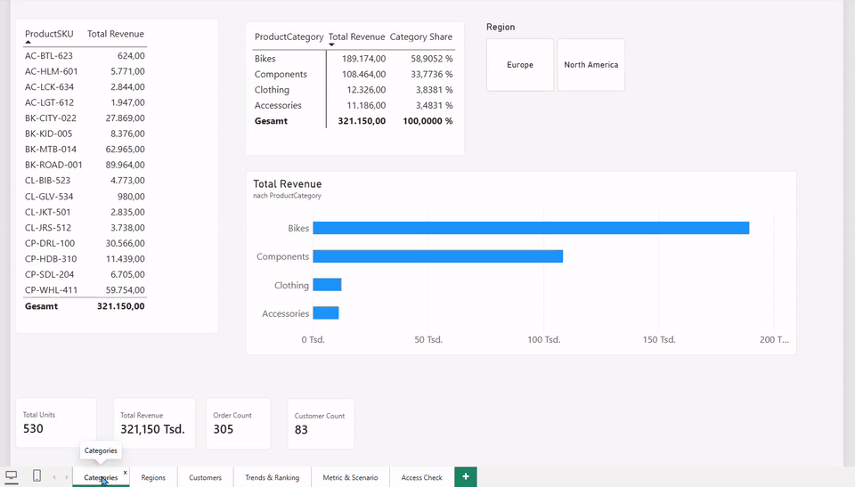
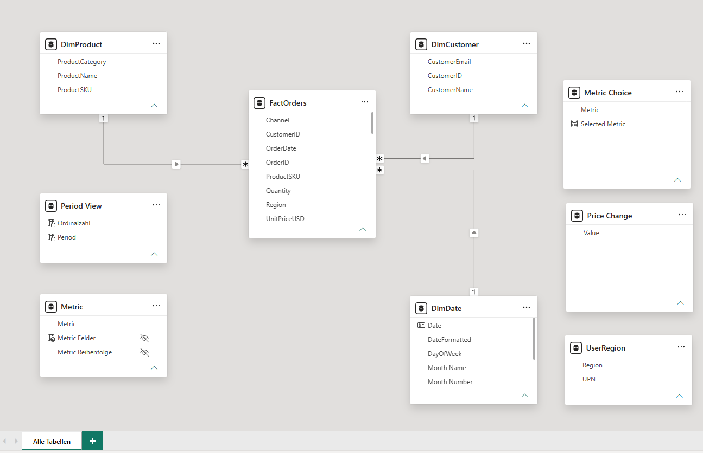
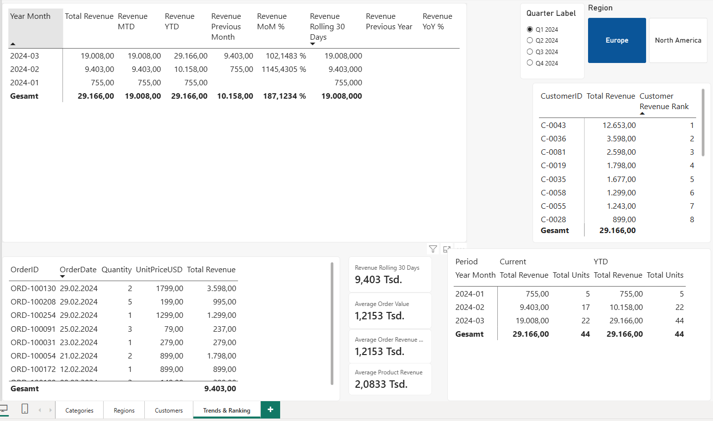
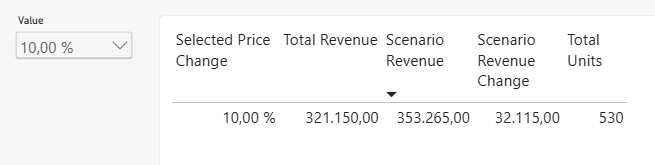
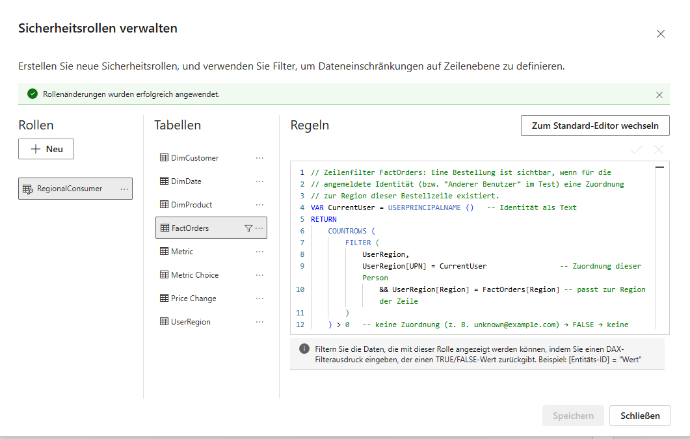
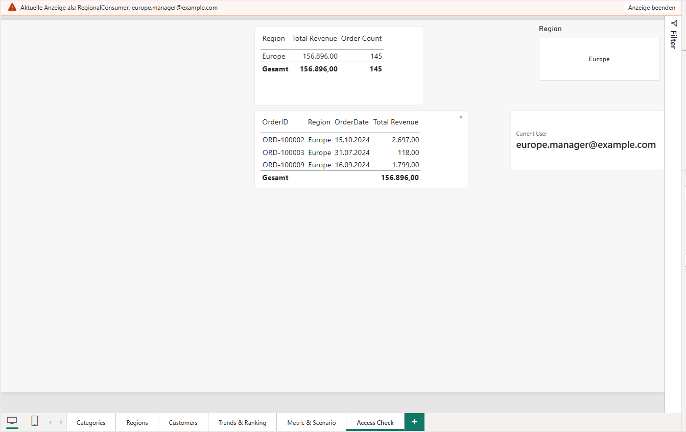
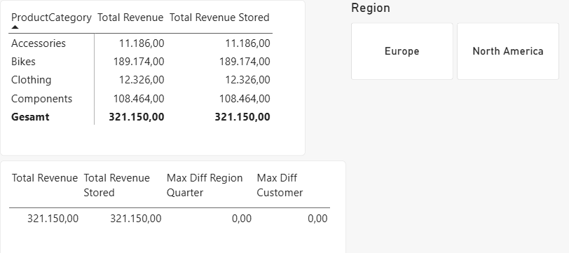

<!--
Datei:      README.md
Projekt:    powerbi-peakflow – Portfolio-Repo zum Projekt im Modul Advanced Power BI (MSIT / Masterschool)
Ersteller:  Milomir Stevanovic
Datum:      24.11.2026

Änderungshistorie
| Version | Datum      | Änderung                                                                 |
|---------|------------|--------------------------------------------------------------------------|
| v01     | 24.11.2026 | Erstfassung aus der Validierungs- und Übergabenotiz v01 und CP4-Notiz v01; GIF aus Bildschirmaufnahme 24.11.2026 |
| v02     | 24.11.2026 | Abschnitt „Dateien und Öffnen“ ergänzt; PBIX und beide CSV aus dem Übergabeordner („Check für weitergabe“) im Repo |
| v03     | 24.11.2026 | „Abschlussprojekt“ ersetzt durch „Projekt im Modul“ (Abschlussprojekt der Weiterbildung ist das spätere Capstone-Projekt) |
-->

# PeakFlow – Vertriebsbericht mit Zeilensicherheit (Power BI)

Projekt im Modul **Advanced Power BI** der Weiterbildung *AI-Powered Data Analyst* (Masterschool Institute of Technology, 2026).
Der Bericht wurde in vier Checkpoints aufgebaut: Grundbericht → Zeitintelligenz und Ranking → Kennzahlwechsel und Preisszenario → Zeilensicherheit, Übergabe und Performance.



*Rundgang durch die sechs Berichtsseiten (doppelte Geschwindigkeit).*

---

## Auf einen Blick

| | |
|---|---|
| **Fragestellung** | Wie verteilt sich der Onlineumsatz des Fahrradhändlers PeakFlow auf Kategorien, Regionen und Kunden, wie entwickelt er sich über die Zeit, und wer darf welche Region sehen? |
| **Daten** | Onlinebestellungen 2024 (synthetische Kursdaten): 305 Bestellungen, 530 Stück, 83 Kunden, 16 Produkte, Umsatz 321.150 USD (Europe 156.896, North America 164.254) |
| **Werkzeuge** | Power BI Desktop, Power Query, DAX, Leistungsanalyse (Performance Analyzer), Python für die Auswertung der Messdaten |
| **Ergebnis** | Sechs Berichtsseiten, dynamische Zeilensicherheit nach Region, alle Kennzahlen gegen Kontrollwerte geprüft |

## Berichtsseiten

| Seite | Beantwortet |
|---|---|
| **Categories** | Umsatz und Anteil je Produktkategorie |
| **Regions** | Europe vs. North America, Quartale, Benchmark-Kennzahlen |
| **Customers** | Umsatz und durchschnittlicher Bestellwert je Kunde |
| **Trends & Ranking** | Monat, YTD, Vormonat, MoM %, rollierende 30 Tage, Kundenrang |
| **Metric & Scenario** | Kennzahl per Feldparameter wechseln, Preisannahme (−20 % … +20 %), Reset-Schaltfläche |
| **Access Check** | Prüfseite für die Zeilensicherheit (vor einer Veröffentlichung ausgeblendet) |

## Datenmodell

Sternschema im Importmodus: `FactOrders` mit `DimProduct`, `DimCustomer` und `DimDate` (1:*, einfache Filterrichtung). Die Staging-Abfrage `Orders_Clean` wird bewusst nicht geladen, weil eine geladene Kopie aller Bestellungen ohne Rollenfilter die Zeilensicherheit umgehen würde. `UserRegion` steht ohne Beziehung im Modell und wird nur in der Sicherheitsregel verwendet.



## Kennzahlen (Auswahl)

Jede Kennzahl ist einmal definiert und wird auf allen Seiten wiederverwendet.

```dax
Total Revenue       = SUMX ( FactOrders, FactOrders[Quantity] * FactOrders[UnitPriceUSD] )
Average Order Value = DIVIDE ( [Total Revenue], [Order Count] )

// Anteil an der aktuellen Auswahl: nur der Kategoriefilter wird aufgehoben
Category Share =
DIVIDE ( [Total Revenue], CALCULATE ( [Total Revenue], REMOVEFILTERS ( DimProduct[ProductCategory] ) ) )
```

Weitere: `Revenue YTD` (DATESYTD), `Revenue Previous Month` (DATEADD), `Revenue MoM %`, `Revenue Rolling 30 Days` (DATESINPERIOD), `Customer Revenue Rank` (RANKX, DENSE), Calculation Group `Period View` (Current / YTD), `Selected Metric` und `Scenario Revenue = Total Revenue × (1 + Preisannahme)`.



*Trends & Ranking mit Filter Europe und Q1 2024: Kunde C-0043 auf Rang 1 mit 12.653.*



*Preisszenario +10 %: 353.265 statt 321.150, die Stückzahl bleibt bei 530 (Annahme: konstante Menge).*

## Zeilensicherheit (RLS)

Eine einzige dynamische Rolle `RegionalConsumer`: Eine Bestellung ist sichtbar, wenn in `UserRegion` für die angemeldete Identität eine Zuordnung zu ihrer Region existiert. Wer keine Zuordnung hat, sieht nichts.

```dax
VAR CurrentUser = USERPRINCIPALNAME ()
RETURN
    COUNTROWS (
        FILTER (
            UserRegion,
            UserRegion[UPN] = CurrentUser
                && UserRegion[Region] = FactOrders[Region]
        )
    ) > 0
```



Getestet in Power BI Desktop mit „Anzeigen als“ und vier Identitäten:

| Identität | Erwartet | Ergebnis |
|---|---|---|
| europe.manager@example.com | nur Europe | 156.896 / 145 Bestellungen ✓ |
| na.manager@example.com | nur North America | 164.254 / 160 Bestellungen ✓ |
| director@example.com | beide Regionen | 321.150 / 305 Bestellungen ✓ |
| unknown@example.com | keine Zeilen | keine Zeilen, Karten leer ✓ |



*Ansicht als europe.manager@example.com: nur Europe-Bestellungen, der Slicer bietet North America nicht mehr an.*

Erkenntnis aus dem Test: Die Rolle wirkt vor jeder Kennzahl. `All Region Revenue` (REMOVEFILTERS) liefert für den Europe-Manager 156.896 statt 321.150. Ein Measure kann einen Berichtsfilter aufheben, aber nicht die Rollengrenze.

## Validierung, Übergabe und Performance

- **Kontrollwerte:** Jede Seite wurde gegen vorher festgelegte Sollwerte geprüft (z. B. Rolling 30 Tage am 29.02. = Summe der Bestelldetails = 11.730).
- **Übergabe:** frische Kopie der PBIX, beide CSV-Quellen in einen neuen Ordner umgestellt, Refresh → 321.150 / 305 ✓.
- **Historische Korrektur:** Menge einer Januarbestellung in der CSV von 2 auf 3 geändert. Nach dem Refresh ergaben sich 322.449, Europe blieb unverändert. Nach der Rücknahme stand der Wert wieder bei 321.150 ✓. Grund: vollständiges Neuladen statt inkrementeller Aktualisierung.
- **Performance:** `SUMX` über zwei Spalten verglichen mit einer gespeicherten Umsatzspalte + `SUM`. Beide liefern dieselben Werte (maximale Abweichung 0 über Region × Quartal und über alle Kunden). Gemessen wurde mit der Leistungsanalyse, je 5 Läufe, ausgewertet mit Python:

| | SUMX (Baseline) | gespeicherte Spalte |
|---|---|---|
| Gesamtzeit, Median | 109 ms (103–118) | 110 ms (103–130) |
| DAX-Abfrage, Median | 5 ms | 5 ms |

**Entscheidung:** Es gibt keinen verlässlichen Unterschied, deshalb bleibt SUMX. Eine zweite Umsatzdefinition würde nur Modellgröße und Pflegeaufwand erhöhen.



## Dateien und Öffnen

| Datei | Inhalt |
|---|---|
| `peakflow_advanced_final.pbix` | fertiger Bericht (Power BI Desktop), die in CP4 getestete Übergabekopie |
| `data/Orders_Clean.csv` | bereinigte Onlinebestellungen 2024 (305 Zeilen, synthetische Kursdaten) |
| `data/user_region_training.csv` | Zuordnung Testidentität → Region für die Zeilensicherheit (nur `@example.com`-Konten) |

So öffnest du den Bericht auf einem anderen Rechner:

1. Lade das Repo herunter und öffne `peakflow_advanced_final.pbix` in Power BI Desktop.
2. Wähle Datei → Optionen und Einstellungen → Datenquelleneinstellungen und für beide CSV-Dateien „Quelle ändern…“. Verweise dort auf den Ordner `data` des Repos.
3. Klicke auf Start → Aktualisieren.
4. Kontrolle auf der Seite Access Check: 321.150 Umsatz und 305 Bestellungen.

## Grenzen

- Nur Daten aus 2024: kein Vorjahresvergleich (YoY bleibt bewusst leer, nicht 0).
- Keine Kostendaten: kein Gewinn. Das Szenario ist eine Preisannahme bei konstanter Menge, keine Nachfrageprognose.
- Die RLS filtert die Faktentabelle, nicht die Dimensionen: Kunden- und Produktlisten bleiben sichtbar, aber ohne Umsatz.
- Kein Zugang zum Power BI Service: Veröffentlichung, geplanter Refresh und Rollenzuweisung echter Konten sind beschrieben, aber nicht getestet. Die RLS wurde lokal mit Trainingskonten geprüft.
- Die Performance wurde nur in Desktop gemessen, auf einem Rechner und mit 305 Zeilen.

---

**Autor:** Milomir Stevanović · [LinkedIn](https://www.linkedin.com/in/milomir-stevanovi%C4%87-2734752ba/) · [GitHub](https://github.com/stevano1966-sudo)
